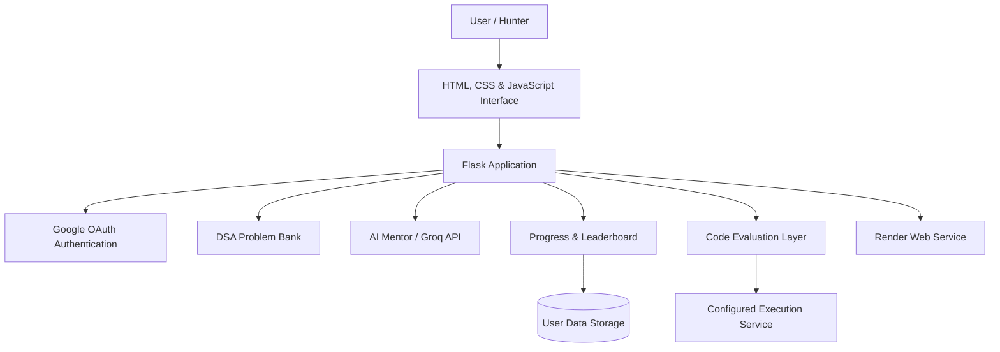

 
<div align="center">

# 👑 DSA KING SYSTEM

### ⚔️ CODE. EVOLVE. ASCEND.

**DSA King System** is an AI-powered Data Structures and Algorithms learning platform that transforms traditional coding practice into an immersive, game-inspired experience.

Master coding challenges, explore AI-powered mentorship, track your progress through XP and Hunter rankings, and sharpen your problem-solving skills in a futuristic coding environment.

**Solve Challenges. Unlock Your Potential. Become the Ultimate Coding King.**

### 🌐 LIVE DEMO

🚀 **Experience DSA King System Live**

[](https://dsa-king-system.onrender.com/)

**Website:** https://dsa-king-system.onrender.com/

### 💻 GITHUB REPOSITORY

[](https://github.com/rohanbhowm25308/DSA-King-System)

**Repository:** https://github.com/rohanbhowm25308/DSA-King-System

### 🛠️ BUILT WITH


</div>

---

##  THE SYSTEM HAS AWAKENED

> "Every expert was once a beginner. Every algorithm was once a mystery. Every coding king started with one line of code."

Traditional coding platforms give you problems.

**DSA King System gives you a journey.**

Inspired by the progression mechanics of fantasy gaming worlds, DSA King System transforms algorithm practice into an interactive developer experience.

Instead of simply solving questions, users enter a Hunter-themed environment where they can practice algorithms, develop problem-solving skills, track achievements, earn experience points, and prepare for technical interviews.

The mission is simple:

**Turn consistent coding practice into visible skill progression.**

---

## ✨ WHAT MAKES DSA KING SYSTEM DIFFERENT?

| Traditional Coding Platform | 👑 DSA King System |
|---|---|
| Basic problem-solving interface | Immersive Hunter-themed coding environment |
| Static practice lists | Structured Easy, Medium, and Hard challenges |
| Simple completion tracking | XP, levels, achievements, and progress analytics |
| Limited guidance | AI-powered coding mentorship |
| Ordinary coding experience | Algorithm dungeons and interactive learning modes |
| Isolated practice | Leaderboards and competitive progression |
| Basic interview questions | Dedicated interview preparation environment |

The objective is not just to solve more problems, but to **understand algorithms, improve coding decisions, and build long-term confidence**.

---

## 🚀 CORE FEATURES

###  01. DSA PROBLEM ARENA

A dedicated coding environment designed for systematic algorithm practice.

- Easy, Medium, and Hard difficulty levels
- Problem descriptions and examples
- Input/output explanations and constraints
- Topic-based algorithm practice
- Integrated coding editor
- Run Code and Submit Code workflows
- Test-case-based evaluation
- Expandable question bank

**Every problem is an opportunity to level up.**

###  02. AI CODING MENTOR

An intelligent learning companion powered by Groq-based AI integration.

Designed to support:

- Understanding difficult programming concepts
- Exploring algorithmic approaches
- Debugging assistance
- Learning time and space complexity
- Improving problem-solving strategies
- Receiving explanations while practicing

**The goal is to help developers understand the solution, not merely copy it.**

###  03. ALGORITHM DUNGEONS

A challenge-oriented experience inspired by gaming progression.

The Dungeon section brings a mission-based feel to algorithm practice, encouraging users to approach programming challenges with curiosity, consistency, and determination.

**Enter the dungeon. Face the algorithm. Conquer the challenge.**

###  04. HUNTER PROGRESS SYSTEM

A personalized progress dashboard that turns coding activity into measurable growth.

- Total solved problems
- Dynamic question-count tracking
- Completion percentage
- Experience points (XP)
- Hunter levels
- Submission statistics
- Daily practice streaks
- Difficulty-wise performance

Progress is tied to distinct solved problems so repeated practice does not artificially inflate completion totals.

###  05. LEADERBOARD & ACHIEVEMENTS

A competitive progression experience featuring:

- Hunter rankings
- XP-based progression
- Achievement milestones
- Coding consistency tracking
- Community-oriented motivation

**Your rank is earned through practice.**

###  06. ALGORITHM VISUALIZER

A dedicated environment for exploring algorithms and building intuition about how they work.

The Visualizer section complements code-based learning by emphasizing the underlying algorithmic process.

###  07. INTERVIEW PREPARATION

A dedicated section for developing the skills needed in technical interviews.

The platform is designed to support structured DSA practice and interview-focused problem-solving.

###  08. COMPANY PREPARATION

A specialized preparation area focused on organizing coding practice around technical recruitment and company-oriented interview readiness.

###  09. ENGINEERING MISSIONS

A section connecting coding practice with broader engineering thinking, helping learners approach programming beyond isolated textbook exercises.

###  10. CODING ARENA

A competitive environment designed around coding challenges, rankings, and continuous improvement.

###  11. GOOGLE AUTHENTICATION

Google OAuth integration provides a convenient sign-in experience and connects users to their personal Hunter profiles.

###  12. IMMERSIVE USER EXPERIENCE

The interface includes:

- Dark futuristic styling
- Electric-blue visual accents
- Hunter-inspired dashboard
- Animated landing experience
- Interactive navigation
- Gaming-inspired progression elements
- Dedicated coding workspace

---

##  EXPLORE THE SYSTEM

| Module | Purpose |
|---|---|
| 🏠 Dashboard | Hunter overview and activity |
| 💻 Problems | Algorithm practice and code submission |
| 🤖 AI Lab | AI-assisted learning |
| ⚔️ Dungeons | Challenge-oriented coding experience |
| 📈 Visualizer | Algorithm exploration |
| 🎤 Interviews | Technical interview preparation |
| 🏢 Company Prep | Company-focused coding practice |
| 🛠️ Engineering | Engineering-oriented challenges |
| 🥊 Arena | Competitive coding experience |
| 🏆 Progress | XP, streaks, rankings, and achievements |

---

##  SYSTEM ARCHITECTURE



The platform combines a lightweight web interface, a Python-based backend, AI integration, coding challenges, and personalized progression.

---

##  TECHNOLOGY STACK

| Layer | Technologies |
|---|---|
| Frontend | HTML5, CSS3, JavaScript |
| Backend | Python, Flask |
| AI Integration | Groq API |
| Authentication | Google OAuth 2.0 |
| Data Management | SQLite-based application storage |
| Code Evaluation | Python evaluation and configurable Judge0 integration |
| Production Server | Gunicorn |
| Deployment | Render |
| Version Control | Git, GitHub |

---

##  LOCAL INSTALLATION

### Prerequisites

- Python 3
- Git
- VS Code or another code editor
- Google OAuth credentials for Google sign-in
- Groq API key for AI features
- A properly configured execution service for supported non-Python languages

### Step 1 — Clone the repository

```bash
git clone https://github.com/rohanbhowm25308/DSA-King-System.git
```

```bash
cd DSA-King-System
```

### Step 2 — Create a virtual environment

```bash
python -m venv .venv
```

Activate it on Windows:

```powershell
.venv\Scripts\Activate.ps1
```

### Step 3 — Install dependencies

```bash
pip install -r requirements.txt
```

### Step 4 — Configure environment variables

Create a `.env` file in the project root and configure the values expected by the backend.

Example:

```env
GOOGLE_CLIENT_ID=your_google_client_id
GOOGLE_CLIENT_SECRET=your_google_client_secret
GROQ_API_KEY=your_groq_api_key
FLASK_SECRET_KEY=your_random_secret_key
```

Additional configuration may be required depending on the selected AI model and code execution backend.

**Never commit `.env`, API keys, OAuth secrets, or local user databases to GitHub.**

### Step 5 — Run the application

```bash
python app.py
```

Open:

```text
http://127.0.0.1:5000
```

Google OAuth requires the appropriate localhost callback URI to be registered in Google Cloud Console.

---

##  DEPLOYMENT

DSA King System is hosted on Render.

**Production URL:**

https://dsa-king-system.onrender.com/

A typical Render configuration uses:

**Build command**

```bash
pip install -r requirements.txt
```

**Start command**

```bash
gunicorn --bind 0.0.0.0:$PORT app:app
```

Configure application secrets using Render's environment variable settings.

The Google OAuth redirect URI must match the deployed HTTPS callback exactly.

For public deployment, user data should be stored persistently, and untrusted code must be evaluated in a securely isolated execution environment.

---

##  THE PHILOSOPHY

DSA King System is built around three principles.

**CODE.** Learn the fundamentals. Understand the problem. Write the solution.

**EVOLVE.** Analyze mistakes. Improve your approach. Build consistency.

**ASCEND.** Develop confidence. Strengthen technical skills. Become interview-ready.

The platform combines algorithmic thinking, AI-assisted learning, and game-inspired motivation into one experience.

---

## 👨‍💻 DEVELOPER

<div align="center">

### Rohan Bhowmik

**Computer Science & Engineering Student**

*AI/ML • Data Science • Generative AI • Python • Full-Stack Development*

Passionate about building intelligent applications that combine practical software engineering, artificial intelligence, and meaningful user experiences.

[](https://github.com/rohanbhowm25308)

[](https://dsa-king-system.onrender.com/)

</div>

---

## ⭐ SUPPORT THE PROJECT

If you find DSA King System interesting or useful:

-  Star the repository
-  Fork the project
-  Report bugs through GitHub Issues
-  Suggest improvements
-  Contribute through pull requests

Your support helps the platform continue evolving.

---

<div align="center">

### 👑 EVERY CODER STARTS AT LEVEL ONE.

### NOT EVERY CODER STOPS THERE.

**DSA KING SYSTEM**

*Code. Evolve. Ascend.*

**© DSA King System — Developed by Rohan Bhowmik**

</div>
